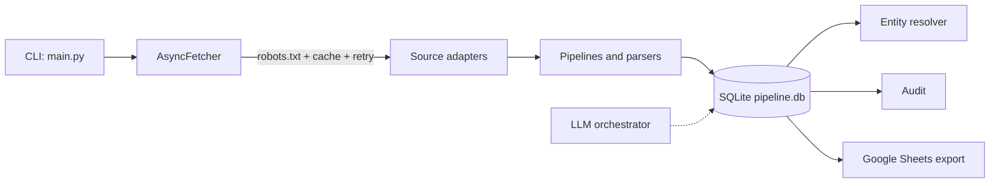

<p align="center">
  
</p>

<p align="center">
  Async data ingestion pipeline with multi-provider LLM extraction, rate-limit handling, and entity resolution.
</p>

<p align="center">
  
  
  
</p>

---

# AI Signal Ingestion

A local, SQLite-backed data pipeline that collects Y Combinator startup records, organization-owned Hugging Face model products, Hugging Face daily papers with GitHub star counts, recent AI news, and AI-related jobs. It uses async HTTP fetching, robots.txt checks, source-specific parsers, and Hugging Face / GitHub enrichment. A set of LLM resilience utilities (fallback chain, backoff, chunking, grounding check) is included for structured extraction.

Most collection commands run without an LLM. The papers, startup and product sources are deterministic, and the news and job pipelines are source parsers plus date and freshness filtering. Every record carries a real source URL and a collection timestamp.



## Output

| Item | Link or value |
|---|---|
| Public Google Sheet | `<paste Sheet link here>` |
| Last full run | `<YYYY-MM-DD HH:MM UTC>` |

The Sheet has six tabs:

| Tab | Content | Rows at last run |
|---|---|---|
| Startups | Y Combinator companies with source URL | `<fill in>` |
| Products | Organization-owned Hugging Face models | `<fill in>` |
| Research Papers | Hugging Face daily papers with GitHub URL, star count and fetch time | `<fill in>` |
| Jobs | AI-related jobs published in the last 24 hours | `<fill in>` |
| News | AI news published in the last 24 hours | `<fill in>` |
| Entity Mapping Log | Raw name, canonical name, method, score | `<fill in>` |

Jobs and News are a snapshot. Only items inside the 24-hour window at run time are kept.

## Data sources

| Vertical | Source | Access method |
|---|---|---|
| Startups | Community Y Combinator dataset (MIT-licensed, `akshaybhalotia/yc_company_scraper`); each URL is the company's real `ycombinator.com/companies/<slug>` page | Public JSON file |
| Products | Hugging Face models, organization-owned only | Public API |
| Research papers | Hugging Face daily papers; star counts from the GitHub API | Public APIs |
| News | Hacker News (Algolia API), TechCrunch, The Verge, Wired, VentureBeat | API and RSS/Atom |
| Jobs | OpenAI, Cohere and Perplexity (Ashby); Anthropic and Scale AI (Greenhouse); FieldAI (Lever); RemoteOK; We Work Remotely | Public JSON APIs and RSS |

Jobs from AI-company boards are kept in full. Jobs from general boards (RemoteOK, We Work Remotely) are kept only when the title or tags match the AI keyword list in `config.yaml`. The `board_type` column records which rule applied.

## Setup

Python 3.12 or newer is required.

```bash
python -m venv .venv

# Windows PowerShell
.\.venv\Scripts\Activate.ps1

# macOS/Linux
source .venv/bin/activate

python -m pip install --upgrade pip
pip install -r requirements.txt
```

Copy `.env.example` to `.env` and fill in the keys you need:

```text
GEMINI_API_KEY=...
GROQ_API_KEY=...
DEEPSEEK_API_KEY=...
GITHUB_TOKEN=...                 # strongly recommended: raises the GitHub API limit
GOOGLE_SERVICE_ACCOUNT_JSON=...  # path to the key file; required for Sheets export
GOOGLE_SHEET_ID=...              # optional existing-sheet export target
LOG_LEVEL=INFO
```

API keys belong in environment variables, never in `config.yaml` and never in git. Keep the Google key file outside the repository.

`config.yaml` controls provider order and model names, provider requests per minute, retry settings, circuit-breaker settings, global and per-domain concurrency and request intervals, the papers target, and the AI keyword list. Scaling the crawl is a configuration change.

## Commands

All commands use `data/pipeline.db` by default.

### Research papers

```bash
python main.py papers --target 20
python main.py papers --target 1000
```

Pages the Hugging Face `/api/daily_papers?date=...` endpoint. The arXiv abstract URL (`https://arxiv.org/abs/<arxiv_id>`) is derived from the arXiv id and is never fetched. The Hugging Face paper page is the `source_url`. GitHub stars come from the GitHub API and are stored with the time they were fetched. Records are unique by `arxiv_id`, so reruns add no duplicates.

### Startups and products

```bash
python main.py startups-products --target 1000
```

Reads the community Y Combinator dataset and pages through organization-owned Hugging Face models. Product records use the model page as `source_url`. `pricingModel` is set to `FREE` only for recognized open-source license tags and is otherwise left empty.

### News and jobs

```bash
python main.py signals
```

Collects the configured news and job sources, normalizes publication dates, applies the 24-hour rule, and refreshes the `news_signals` and `job_signals` tables. Each row stores the item URL as `source_url` and the feed or API endpoint as `feed_url`.

### Entity resolution

```bash
python main.py resolve
```

Resolves distinct startup, product and job-company names against the seed list in `src/resolver/seed_startups.json` using exact, alias and conservative fuzzy matching, and writes every decision to `entity_log`.

### Google Sheets export

```bash
python main.py export
python main.py export --sheet-id <existing-spreadsheet-id> --sheet-title "AI Data"
```

Writes the six tabs described above. Rerunning clears and rewrites them, so the export is idempotent.

### Audit

```bash
python main.py audit
python main.py audit --sample-size 10
```

Checks minimum counts, provenance (source URL and timestamp on every row), duplicates, 24-hour freshness for jobs and news, the pricing enum, entity-log completeness, and a random sample of source URLs.

### Tests

```bash
python -m pytest -q
```

The suite uses mocks and injected clocks and sleep functions, so HTTP, retry, rate-limit, circuit-breaker and pipeline tests are fast and deterministic.

## Design decisions

- **Async crawler.** `AsyncFetcher` uses `httpx` with a global semaphore, per-domain semaphores, per-domain minimum request intervals, robots.txt parsing, ETag caching and SQLite raw-page persistence. Query-string secrets are removed from logs.
- **Fallback chain.** The LLM module tries Gemini, then Groq, then DeepSeek. A provider is skipped while its circuit breaker is open.
- **429 handling.** Retryable failures use exponential backoff capped at a configured maximum, with `Retry-After` preferred when the server sends it. Jitter is sampled uniformly from 0.5 to 1.5 times the delay, so concurrent tasks do not retry at the same moment. A per-provider token bucket keeps requests under the provider limit, and a 429 pauses the bucket for all waiting tasks.
- **413 handling.** The chunker removes boilerplate, keeps the title and headings, ranks paragraphs by information density, and truncates to a token budget. On a 413 the orchestrator shrinks the text to 60% of its previous size and retries the same provider, up to three times, before falling back.
- **Grounding check (anti-hallucination).** The LLM only structures text that was already fetched. Every extracted string must appear in the source text after normalization, and numbers must appear verbatim. Results that fail are rejected and the next provider is tried. URLs, dates and GitHub star counts are always produced by deterministic code, never by an LLM.
- **Circuit breaking.** A provider's breaker opens after five consecutive failures, waits for the cooldown, then allows a single trial request.
- **Dead-letter queue.** If every provider fails, the item is saved to `pending_extractions` with a retry time and is not dropped.
- **Dedupe.** Startups and products use the canonical source URL as primary key, papers use a unique `arxiv_id`, and signals use a canonical URL plus a normalized text hash.
- **Freshness.** Items with a verified timestamp must be within 24 hours and not in the future. The date normalizer tries the API or RSS timestamp, JSON-LD, meta tags, relative strings such as "2 hours ago", and URL dates, and records which method succeeded. Items with no date at all use a seen-item hash and are marked as inferred "new since last run", never presented as a verified publication time.
- **Entity resolution.** Names are normalized (case, punctuation, legal suffixes), then matched by exact name, alias, and finally fuzzy match with a high threshold and a required margin over the runner-up. Anything below the threshold stays `UNRESOLVED` instead of being forced into a wrong match.

## Anti-bot strategy

The pipeline prefers official APIs, RSS feeds and public JSON endpoints, which avoids bot protection entirely. For sources behind Cloudflare, Datadome or heavy JavaScript rendering, the approach is tiered:

1. Official API, data dump or licensed data feed.
2. Plain async HTTP with a descriptive User-Agent, conditional requests (ETag), per-domain rate limits, retries with jitter and caching.
3. Playwright (async) with realistic browser contexts, session and cookie reuse, and randomized delays for JavaScript-rendered pages.
4. A managed unblocking service or a data partnership for aggressively protected sources.

Captcha solving and overriding an explicit robots.txt disallow are out of scope by design. This repository implements tiers 1 and 2. Tiers 3 and 4 are documented only.

## Architecture and scale

See `architecture.pdf` for the scale strategy (500,000+ records), 413 and 429 handling across thousands of concurrent extractions, cross-node deduplication, and the storage design. In short: a distributed queue with stateless workers, a shared Redis token bucket per LLM provider, a unique canonical-URL and content-hash key for idempotent writes, and Postgres (with pgvector) plus a graph layer for relationships. That design is proposed, not implemented here.

## Limitations

- **No arXiv API use.** `https://export.arxiv.org/robots.txt` disallows all paths, so the arXiv API is not used. `arxiv.py` stays in the repository for reference only. Papers come from Hugging Face daily papers, which lean toward popular papers, and their pagination is by date and can include empty days.
- **Local scale.** Storage is SQLite, resume is in-process, and the provider token buckets are in-process. Redis, distributed queues, stateless workers and Postgres are proposed architecture, not implemented.
- **LLM layer not wired into collection.** The providers, orchestrator and grounding check are implemented and tested, but no collection command currently calls them. `pending_extractions` is persisted, and no command drains it yet.
- **Startup data comes from a community dataset**, not a live crawl of ycombinator.com. Some companies may have been renamed or removed since it was built.
- **Product owners are not always startups.** Organization-owned Hugging Face models include large companies. `pricingModel` is empty for most products, because only explicit open-source license tags set `FREE`.
- **Most entities are `UNRESOLVED`.** The seed list holds about 50 well-known AI companies, so most of the thousands of startup names are intentionally left unresolved instead of being matched wrongly.
- **Small, honest signal counts.** Jobs and News are only the items published in the last 24 hours at run time. Several AI-company job boards (Scale AI, Cohere, Perplexity, FieldAI) and RemoteOK had no postings in that window at the time of the run. Hacker News dates are submission times, not the publication time of the linked page.
- **Keyword-based AI filter.** The job relevance filter for general boards is a keyword match, so some loosely related roles pass.
- **GitHub stars are best-effort.** Counts change constantly, so each row stores the fetch time. Repositories that return 404 are counted and skipped.
- **Robots.txt handling fails open** if the file returns 404, a 5xx error, or cannot be reached. It never bypasses an explicitly disallowed path.
- **No browser automation or proxies.** Playwright, proxy pools, session managers and CAPTCHA handling are not implemented.
- **Audit sampling needs network.** The random URL sample makes real requests, so its results depend on current remote availability.

## Repository layout

```text
src/
  config.py            typed settings loaded from config.yaml
  schemas.py           record models
  crawler/             AsyncFetcher and source adapters
  parsers/             date normalization
  llm/                 providers, orchestrator, retry, rate limit, breaker, chunker
  pipelines/           papers, startups and products, signals
  resolver/            entity resolver and seed list
  export/              Google Sheets export and audit
  storage/             SQLite helpers
tests/                 unit and pipeline tests
main.py                command line entry point
config.yaml            all tunable settings
architecture.pdf       design document
```
