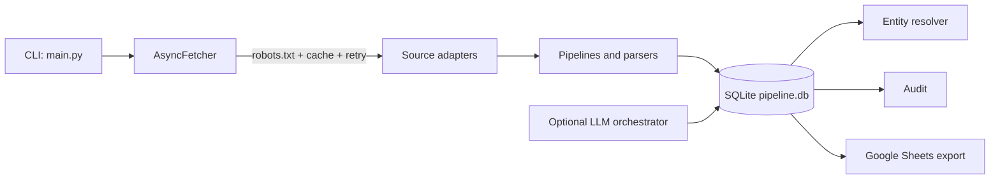

# AI Data Ingestion Pipeline

This repository is a local, SQLite-backed data pipeline for collecting Y Combinator startup records, organization-owned Hugging Face model products, Hugging Face daily papers, recent AI news, and AI-related jobs. It uses async HTTP fetching, robots.txt checks, source-specific parsers, arXiv/GitHub/Hugging Face enrichment, and optional LLM resilience utilities for structured extraction. Most collection commands run without an LLM: the papers source is deterministic, startup/product collection is deterministic, and the news/job pipelines are source parsers plus date/freshness filtering.



## Setup

Python 3.12 or newer is required.

```bash
python -m venv .venv

# Windows PowerShell
.\.venv\Scripts\Activate.ps1

# macOS/Linux
source .venv/bin/activate

python -m pip install --upgrade pip
pip install -r requirements.txt
```

Copy `.env.example` to `.env`. The current startup/config code reads these keys:

```text
GEMINI_API_KEY=...
GROQ_API_KEY=...
DEEPSEEK_API_KEY=...
GITHUB_TOKEN=...                 # optional, improves GitHub API limits
GOOGLE_SERVICE_ACCOUNT_JSON=...  # optional, required for Sheets export
GOOGLE_SHEET_ID=...              # optional existing-sheet export target
LOG_LEVEL=INFO
```

`config.yaml` controls:

- provider order and model names;
- provider RPM values;
- retry base, cap, and maximum attempts;
- circuit-breaker threshold and cooldown;
- global crawler concurrency;
- per-domain concurrency and minimum request interval;
- papers target and legacy category settings;
- AI keywords.

API keys belong in environment variables, not `config.yaml`.

Google Sheets export also needs `gspread` and `google-auth`; these packages are not currently listed in `requirements.txt`. Install them explicitly before using `export`:

```bash
pip install gspread google-auth
```

## Commands

All commands use `data/pipeline.db` by default.

### Research papers

```bash
python main.py papers --target 20
python main.py papers --target 1000
```

The papers pipeline pages the Hugging Face `/api/daily_papers?date=...` endpoint. It derives the arXiv abstract URL as `https://arxiv.org/abs/<arxiv_id>`, uses the Hugging Face paper URL as `source_url`, and resolves GitHub stars through GitHub's API. It does not fetch or use the arXiv API. Records are unique by `arxiv_id`.

### Startups and products

```bash
python main.py startups-products --target 1000
```

This fetches the MIT-licensed Y Combinator community dataset and paginates organization-owned Hugging Face models. The Hugging Face organization check is an API lookup. Product records are saved with a model-page source URL and a pricing value of `FREE` only for recognized open-source license tags.

### News and jobs

```bash
python main.py signals
```

This collects configured news RSS/API sources and job-board APIs, applies the 24-hour freshness rule where verified timestamps exist, and saves/refreshes the `news_signals` and `job_signals` tables.

### Entity resolution

```bash
python main.py resolve
```

This resolves distinct startup/product/job company names using exact, alias, and conservative fuzzy matching from `src/resolver/seed_startups.json`, and writes cached results to `entity_log`.

### Google Sheets export

```bash
python main.py export
python main.py export --sheet-id <existing-spreadsheet-id> --sheet-title "AI Data"
```

Export creates or updates six tabs: `Startups`, `Products`, `Research Papers`, `Jobs`, `News`, and `Entity Mapping Log`. Credentials and optional sheet ID are supplied by environment variables or CLI arguments.

### Audit

```bash
python main.py audit
python main.py audit --sample-size 10
```

The audit checks minimum counts, provenance, duplicates, 24-hour jobs/news freshness, product pricing enum values, entity-log completeness, and a random source-URL sample. The scale thresholds remain 1,000 rows for startups, products, and papers.

### Tests

```bash
pytest -q
# or
uv run pytest -q
```

The suite uses mocks and injected clocks/sleep functions for deterministic HTTP, retry, rate-limit, breaker, and pipeline tests.

## Design decisions

- **Async crawler:** `AsyncFetcher` uses `httpx`, a global semaphore, per-domain semaphores, minimum inter-request intervals, robots.txt parsing, ETag caching, and SQLite raw-page persistence.
- **Fallback chain:** the LLM module implements ordered Gemini → Groq → DeepSeek fallback. The configured providers are not invoked by the current `papers`, `signals`, `startups-products`, `resolve`, `export`, or `audit` commands; they are reusable but presently standalone infrastructure.
- **429 backoff and jitter:** retryable HTTP failures use exponential delay capped at the configured maximum. `Retry-After` is preferred when supplied. Jitter is uniformly sampled from 0.5–1.5 times the delay.
- **413 handling:** the LLM orchestrator applies up to three text reductions (60% of the previous text each time) and retries the same provider before moving to fallback providers.
- **Grounding check:** every LLM string result must normalize to a substring of the source text; numeric values must appear verbatim. Meta fields such as `source_url` and `extracted_by` are excluded. Failed grounding moves to the next provider.
- **Circuit breaking:** provider circuit breakers open after five consecutive failures, wait for a configured cooldown, and allow one HALF_OPEN probe.
- **Dedupe:** startups/products use canonical source URL primary keys, papers use unique `arxiv_id`, and signals use a canonical URL plus normalized text hash.
- **Freshness:** dated news/job records must be within 24 hours and not in the future. Undated items use a first-run baseline plus canonical/hash unseen-item filtering; their freshness is inferred as “new since last run,” not treated as verified publication time.
- **Resume:** startup/product and paper inserts ignore duplicates. Papers also compare existing `arxiv_id` values before GitHub/star work. Signal processing is based on stored seen-item hashes.

## Limitations

- arXiv's API host is intentionally not used. `https://export.arxiv.org/robots.txt` disallows `/`; the repository keeps `arxiv.py` only for compatibility/reference.
- The papers pipeline is Hugging Face daily-papers based. Its historical pagination is by date and can include empty days.
- The current scale is local: SQLite, in-process semiautomatic resume, and in-process provider token buckets. Redis, distributed queues, stateless workers, and Postgres are proposed architecture, not implemented here.
- The LLM providers and grounding/orchestration module are implemented and tested, but no current CLI command wires it into a collection pipeline. `pending_extractions` is persisted, but no CLI retry-drain worker is implemented.
- Google Sheets export requires extra packages not declared in `requirements.txt` and service-account credentials.
- GitHub star resolution is best-effort. Repository 404s are counted, and missing or invalid GitHub links do not create a paper record.
- Free-tier provider limits vary. The code has no durable provider accounting, Redis limits, or paid-subscription guarantees.
- Robots.txt handling fails open if a `robots.txt` request returns 404 or 5xx or is unreachable; it does not bypass an explicitly disallowed path.
- No Playwright, proxy pool, CAPTCHA-solving, cookie/session manager, or anti-bot bypass is implemented.
- The random source audit makes real HEAD/GET requests and will depend on network access and current remote availability.
